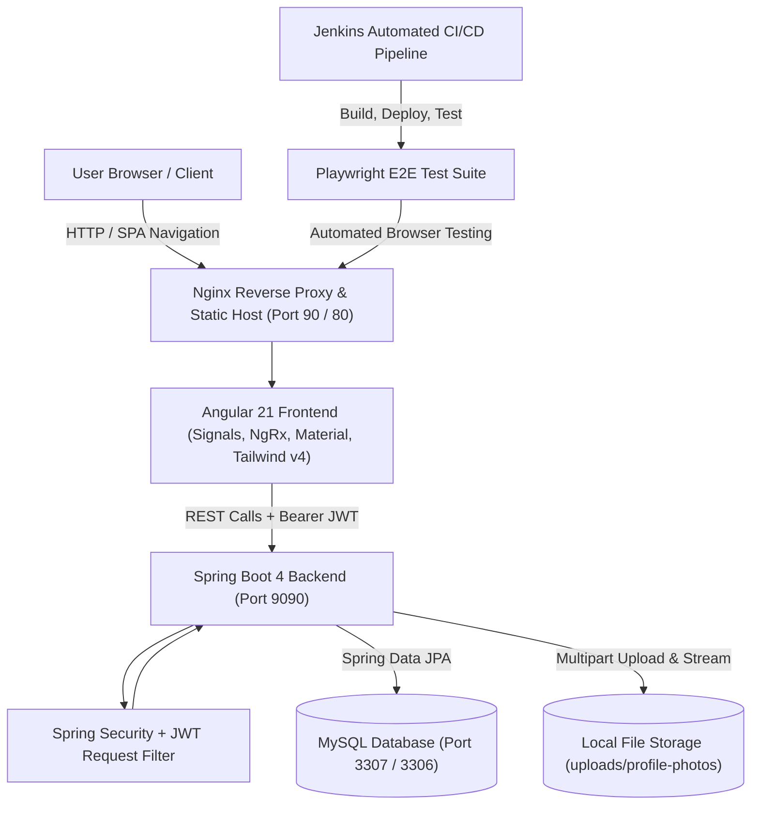
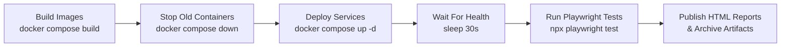

# 🚀 Employee Management System (EMS Portal)

[](https://angular.dev/)
[](https://spring.io/projects/spring-boot)
[](https://www.oracle.com/java/)
[](https://tailwindcss.com/)
[](https://www.mysql.com/)
[](https://www.docker.com/)
[](https://playwright.dev/)
[](https://www.jenkins.io/)
[](https://opensource.org/licenses/MIT)

A modern, enterprise-ready **Employee Management System (EMS Portal)** engineered with a full-stack architecture. Built with **Angular 21** (featuring Standalone Components, Signals, and NgRx State Management), a secure **Spring Boot** REST backend with **JWT** and **RBAC**, a containerized **MySQL** database, automated **Playwright E2E** testing, and a complete **Jenkins CI/CD** pipeline.

---

## 📑 Table of Contents

- [Architectural Overview](#-architectural-overview)
- [Key Features](#-key-features)
  - [Authentication & Role-Based Access Control](#-authentication--role-based-access-control-rbac)
  - [Employee Lifecycle Management](#-employee-lifecycle-management-crud)
  - [Profile Photo & File Upload System](#-profile-photo--file-upload-system)
  - [Modern Dashboard & Real-Time Filtering](#-modern-dashboard--real-time-filtering)
  - [Built-in Tutorial Center ("How To Use")](#-built-in-tutorial-center-how-to-use)
  - [Interactive API Documentation (Swagger)](#-interactive-api-documentation-swagger--openapi)
- [Comprehensive Technology Stack](#-comprehensive-technology-stack)
- [Repository Structure](#-repository-structure)
- [Getting Started](#-getting-started)
  - [Prerequisites](#prerequisites)
  - [Quickstart with Docker Compose (Recommended)](#option-1-quickstart-with-docker-compose-recommended)
  - [Manual Local Development Setup](#option-2-manual-local-development-setup)
- [REST API Reference](#-rest-api-reference)
- [Automated Testing & Quality Assurance](#-automated-testing--quality-assurance)
  - [Playwright E2E Testing](#playwright-end-to-end-testing)
  - [Frontend Unit Testing](#frontend-unit-testing-vitest)
  - [Backend Unit & Integration Testing](#backend-testing-maven)
- [CI/CD Pipeline (Jenkins)](#-cicd-pipeline-jenkins)
- [Environment Variables & Configuration](#-environment-variables--configuration)
- [Roadmap & Future Enhancements](#-roadmap--future-enhancements)
- [Author & License](#-author--license)

---

## 🏛️ Architectural Overview



---

## ✨ Key Features

### 🔐 Authentication & Role-Based Access Control (RBAC)
- **User Registration & Login**: Validated signup and login forms with password encryption using Spring Security's `BCryptPasswordEncoder`.
- **Stateless JWT Security**: Issues JSON Web Tokens (JJWT) with configurable expiration (`EXP_TIMEOUT=86400000` / 24 hrs) for secure API communication.
- **Granular Roles**: Role entity initialization on startup supporting:
  - `ROLE_ADMIN`
  - `ROLE_HR`
  - `ROLE_EMPLOYEE`
  - `ROLE_MANAGER`
  - `ROLE_LEAD`
- **Method-Level Security**: Server-side access restriction via `@PreAuthorize("hasRole('ADMIN')")` ensuring only authorized personnel perform destructive operations (e.g., employee deletion).
- **Angular HTTP Interceptors**:
  - `token-interceptor`: Automatically attaches Bearer JWT authorization headers to all authenticated backend requests.
  - `global-error-interceptor`: Centralized HTTP error handling, catching `401 Unauthorized` and `403 Forbidden` responses with automated redirects and user-friendly toast alerts.

### 👨‍💼 Employee Lifecycle Management (CRUD)
- **Comprehensive Profile Data**: Tracks full employee records including:
  - Personal Information (Full Name, Date of Birth, Age, Phone, Email, Location)
  - Employment Details (Department, Position/Job Title, Joining Date, Salary, Status)
  - Profile Photo URL
- **Reactive Forms & Validation**: Built with Angular `FormGroup` and `Validators` enforcing strict patterns for mobile phone numbers (`^[0-9]{10}$`), valid emails, and required field invariants.
- **Dynamic Employee Modal**: Modern Material dialog (`MatDialog`) supporting both creation mode and edit/patch mode with reactive pre-fill.
- **Role-Protected Deletion**: Admin confirmation prompt before permanently deleting employee records from the database.

### 🖼️ Profile Photo & File Upload System
- **Drag-and-Drop & File Picker**: Integrated avatar uploader powered by modern Angular **Signals** (`selectedFile`, `imagePreview`, `isUploading`, `isDragging`).
- **Supported Formats**: Accepts `PNG`, `JPG`, `JPEG`, `WEBP`, and `GIF` images with client and server-side size limits (5 MB).
- **Dedicated Backend File Service**:
  - `POST /api/files/upload`: Securely saves files to the filesystem and returns a unique file identifier.
  - `GET /api/files/view/{fileName}`: Streams media inline with appropriate MIME types and cache headers (`public, max-age=86400`).
  - `GET /api/files/download/{fileName}`: Downloads files with explicit `Content-Disposition` attachments.
  - `DELETE /api/files/{fileName}`: Removes uploaded files from storage.

### 📊 Modern Dashboard & Real-Time Filtering
- **KPI Summary Cards**: Real-time metric cards showing total employees, active staff counts, department allocations, and operational stats.
- **Debounced Search**: Seamless search field driven by RxJS `debounceTime(300)` and `distinctUntilChanged()`, querying by employee name or email without redundant API hits.
- **Multi-Factor Filtering**:
  - Department dropdown filter (Engineering, HR, Marketing, Finance, Sales, etc.).
  - Status toggle buttons (**All**, **Active**, **On Leave**).
- **Client-Side Pagination**: Clean pagination control with configurable page size (8 per page) and dynamic visible page windows.
- **Collapsible Responsive Sidebar**: Clean sidebar navigation with smooth transition animations and mobile-friendly responsiveness.
- **User Avatar Menu**: Top navigation avatar menu displaying active user session information and one-click logout.

### 🎓 Built-in Tutorial Center ("How To Use")
- **Integrated Video Player**: Interactive video walkthrough available at `/how-to-use` with media controls, direct download button, and playback tips.
- **Feature Quick-Reference**: Grid of card guides covering adding employees, searching/filtering, editing records, uploading photos, status toggles, and administrative deletion.

### 📖 Interactive API Documentation (Swagger / OpenAPI)
- Integrated with **Springdoc OpenAPI 3.0** (`springdoc-openapi-starter-webmvc-ui: 2.8.9`).
- Complete interactive API UI with JWT Bearer authentication scheme configured out-of-the-box.
- Accessible directly at `http://localhost:9090/swagger-ui/index.html`.

---

## 🛠️ Comprehensive Technology Stack

### Frontend (`ems-frontend`)
| Technology | Version | Purpose |
| :--- | :--- | :--- |
| **Angular** | `21.0.0` / `21.2.4` | Core frontend framework (Standalone Components, Routing, Resolvers) |
| **Angular Signals** | `21.0.0` | Reactive state primitives for upload progress, previews, and UI flags |
| **NgRx Store & Effects**| `^21.1.0` | Centralized enterprise state management & devtools integration |
| **TypeScript** | `~5.9.2` | Strongly-typed JavaScript superset |
| **Tailwind CSS** | `^4.1.12` | Modern utility-first styling with `@tailwindcss/postcss` |
| **Angular Material & CDK** | `^21.2.4` | UI components (Dialogs, Buttons, Icons, Form Fields, Selects) |
| **RxJS** | `~7.8.0` | Reactive streams, debouncing, and observable compositions |
| **ngx-toastr** | `^20.0.5` | Toast alert system for errors, warnings, and success feedbacks |
| **Vitest & JSDOM** | `^4.0.8` | High-performance unit testing engine for Angular components |
| **Nginx** | `alpine` | Production web server delivering the production Angular build |

### Backend (`ems-backend`)
| Technology | Version | Purpose |
| :--- | :--- | :--- |
| **Java** | `21` (LTS) | Modern Java runtime |
| **Spring Boot** | `4.0.6` | Application framework and inversion of control |
| **Spring Security** | `6.x` / `4.x` | Stateless authentication, authorization, and CORS handling |
| **JJWT (io.jsonwebtoken)**| `0.11.5` | JSON Web Token (JWT) generation, signing, and verification |
| **Spring Data JPA** | Latest | Object-Relational Mapping (ORM) and repository abstractions |
| **Hibernate** | Latest | Database persistence provider (`ddl-auto=update`) |
| **MapStruct** | `1.6.3` | High-performance compile-time bean mapping between DTOs and Entities |
| **Lombok** | Latest | Boilerplate reduction for getters, setters, constructors, and builders |
| **Springdoc OpenAPI UI** | `2.8.9` | OpenAPI 3.0 specification and interactive Swagger documentation |
| **MySQL Connector/J** | Runtime | MySQL database JDBC driver |

### Database (`ems-database`)
| Technology | Details |
| :--- | :--- |
| **MySQL** | `8.0` container with custom configuration (`my.cnf`) and auto-schema generation |

### Testing & QA (`ems-e2e`)
| Technology | Version | Purpose |
| :--- | :--- | :--- |
| **Playwright** | `^1.61.1` | Cross-browser End-to-End automated testing (Chromium, Firefox, WebKit) |
| **Page Object Model (POM)** | Native | Maintainable test architecture (`loginPage.ts`, `signupPage.ts`) |
| **Playwright HTML Report** | Native | Comprehensive execution dashboards, screenshots, and test traces |

### DevOps & Orchestration
| Tool | Purpose |
| :--- | :--- |
| **Docker** | Multi-stage Dockerfiles for both frontend (Node build + Nginx) and backend (Maven build + Temurin JRE) |
| **Docker Compose** | Multi-container orchestration linking `ems-frontend`, `ems-backend`, and `ems-mysqldb` |
| **Jenkins** | Declarative CI/CD pipeline (`Jenkinsfile`) automating build, container deployment, and Playwright execution |

---

## 📂 Repository Structure

```text
employee-management-system/
│
├── ems-backend/                       # Spring Boot Application
│   ├── src/
│   │   ├── main/
│   │   │   ├── java/com/app/ems/
│   │   │   │   ├── config/            # SecurityConfig, SwaggerConfig
│   │   │   │   ├── controller/        # AuthController, EmployeeController, FileUploadController
│   │   │   │   ├── dto/               # Request/Response Data Transfer Objects
│   │   │   │   ├── entities/          # Employee, User, Role, UserRole, BaseEntity
│   │   │   │   ├── exc_handler/       # Global exception handlers
│   │   │   │   ├── filters/           # JWTRequestFilter
│   │   │   │   ├── init/              # RoleInitializer (auto-seeds user roles)
│   │   │   │   ├── mapper/            # MapStruct mappers
│   │   │   │   ├── repo/              # EmployeeRepository, UserRepository, RoleRepository
│   │   │   │   ├── security/          # CustomUserDetails, CustomUserDetailsService
│   │   │   │   ├── service/           # EmployeeService, UserService, FileUploadService
│   │   │   │   └── utils/             # JWTUtils
│   │   │   └── resources/
│   │   │       └── application.properties # App, DB, JWT, and upload configs
│   ├── uploads/profile-photos/        # Storage directory for uploaded employee photos
│   ├── Dockerfile                     # Multi-stage Maven + Eclipse Temurin 21 JRE image
│   └── pom.xml                        # Maven dependencies & build plugins
│
├── ems-frontend/                      # Angular 21 Application
│   ├── src/
│   │   ├── app/
│   │   │   ├── components/
│   │   │   │   ├── auth/              # Login, Signup, AuthService
│   │   │   │   ├── dashboard/         # Dashboard table, metrics, sidebar, filters
│   │   │   │   ├── employee/          # Add/Edit Employee dialog, Employee & File services
│   │   │   │   ├── how-to-use/        # Video tutorial & quick feature guide
│   │   │   │   └── user-avatar/       # User avatar component & session display
│   │   │   ├── core/
│   │   │   │   ├── interceptor/       # TokenInterceptor, GlobalErrorInterceptor
│   │   │   │   └── resolvers/         # EmployeeResolver
│   │   │   ├── store/                 # NgRx Actions, Effects, Reducers, Selectors, State
│   │   │   ├── app.config.ts          # Application providers, animations, interceptors
│   │   │   └── app.routes.ts          # Angular route definitions
│   │   ├── styles.css                 # Global CSS + Tailwind v4 imports
│   │   └── material-theme.scss        # Angular Material theme definitions
│   ├── default.conf                   # Nginx reverse proxy configuration
│   ├── Dockerfile                     # Multi-stage Node 22 build + Nginx Alpine image
│   └── package.json                   # Angular 21, NgRx, Tailwind, Material dependencies
│
├── ems-database/                      # MySQL Database Image
│   ├── Dockerfile                     # Custom MySQL container image
│   └── my.cnf                         # Database configuration
│
├── ems-e2e/                           # Playwright E2E Test Suite
│   ├── Pages/                         # Page Object Model (POM: loginPage, signupPage)
│   ├── tests/                         # E2E test specs (auth, smoke tests)
│   ├── playwright.config.ts           # Playwright runners, reporters, base URL config
│   └── package.json                   # Playwright test scripts & dependencies
│
├── docker-compose.yml                 # Full-stack Docker Compose configuration
├── Jenkinsfile                        # Jenkins CI/CD declarative pipeline
└── README.md                          # Project documentation
```

---

## ⚙️ Getting Started

### Prerequisites

Ensure you have the following installed on your host system:
- **Git**
- **Docker** & **Docker Compose** (for containerized deployment)
- *Or for manual development:*
  - **Node.js** (v20+ or v22 LTS) & **npm**
  - **Java JDK 21** & **Maven 3.9+**
  - **MySQL 8.0**

---

### Option 1: Quickstart with Docker Compose (Recommended)

Run the entire application stack (Frontend, Backend, and Database) with a single command:

```bash
# Clone the repository
git clone https://github.com/ArjunKhade/ems-portal.git
cd ems-portal

# Build and start all services in the background
docker compose up --build -d
```

#### Service URLs & Ports

| Service | Host Port | Internal Port | URL |
| :--- | :--- | :--- | :--- |
| **Frontend (Angular / Nginx)** | `90` | `80` | `http://localhost:90` |
| **Backend (Spring Boot)** | `9090` | `9090` | `http://localhost:9090` |
| **Swagger UI** | `9090` | `9090` | `http://localhost:9090/swagger-ui/index.html` |
| **MySQL Database** | `3307` | `3306` | `localhost:3307` (`root` / `root`) |

To stop the containers:
```bash
docker compose down
```

---

### Option 2: Manual Local Development Setup

#### 1. Database Setup
Start a local MySQL server or spin up the MySQL container only:
```bash
docker compose up -d ems-mysqldb
```
- Host Port: `localhost:3307` (or `3306` if using a native MySQL installation)
- Database: `ems`
- User: `root`
- Password: `root`

#### 2. Backend Setup (Spring Boot)
```bash
cd ems-backend

# If using local MySQL on port 3307:
# Ensure application.properties or environment points to localhost:3307
mvn clean install
mvn spring-boot:run
```
The backend API will start on **`http://localhost:9090`**.

#### 3. Frontend Setup (Angular 21)
```bash
cd ems-frontend

# Install dependencies
npm install

# Start the Angular development server
npm start
```
The frontend application will be running at **`http://localhost:4200`**.

---

## 🔗 REST API Reference

All protected endpoints require the HTTP Header: `Authorization: Bearer <JWT_TOKEN>`.

### 🔑 Authentication (`/api/auth`)
| Method | Endpoint | Access | Description |
| :--- | :--- | :--- | :--- |
| `POST` | `/api/auth/signup` | Public | Register a new user (`name`, `email`, `password`, `phone`, `role`) |
| `POST` | `/api/auth/login` | Public | Authenticate user credentials and receive a JWT token + user profile |

### 👨‍💼 Employee Management (`/api/employees`)
| Method | Endpoint | Access | Description |
| :--- | :--- | :--- | :--- |
| `GET` | `/api/employees` | Authenticated | Retrieve list of all employees |
| `GET` | `/api/employees/{empId}`| Authenticated | Retrieve specific employee details by ID |
| `POST` | `/api/employees` | Authenticated | Register a new employee record |
| `PUT` | `/api/employees/{empId}`| Authenticated | Update an existing employee's details |
| `DELETE`| `/api/employees/{empId}`| `ROLE_ADMIN` | Delete an employee by ID (Restricted to Admins) |

### 📁 File & Profile Photo Management (`/api/files`)
| Method | Endpoint | Access | Description |
| :--- | :--- | :--- | :--- |
| `POST` | `/api/files/upload` | Public / Auth | Upload profile picture or document (`multipart/form-data`, max 5MB) |
| `GET` | `/api/files/view/{fileName}` | Public / Auth | Stream and view file inline with caching headers |
| `GET` | `/api/files/download/{fileName}` | Public / Auth | Download file with attachment content-disposition |
| `DELETE`| `/api/files/{fileName}` | Authenticated | Delete an uploaded file from disk |

---

## 🧪 Automated Testing & Quality Assurance

### Playwright End-to-End Testing
The `ems-e2e` package contains end-to-end automated tests implemented with the **Page Object Model (POM)** pattern.

```bash
cd ems-e2e

# Install Playwright and browser binaries
npm install
npx playwright install

# Run all E2E tests headless
npm test

# Run smoke test suite
npm run smoke

# Run tests in headed browser mode
npm run headed

# Launch the interactive Playwright UI mode
npm run ui

# View generated HTML test execution report
npm run report
```

### Frontend Unit Testing (Vitest)
```bash
cd ems-frontend
npm test
```

### Backend Testing (Maven)
```bash
cd ems-backend
mvn test
```

---

## 🔄 CI/CD Pipeline (Jenkins)

The project includes a production-grade declarative `Jenkinsfile` that automates continuous integration and deployment:



1. **Build Images**: Builds Docker images for `ems-backend`, `ems-frontend`, and `ems-database`.
2. **Stop Old Containers**: Gracefully tears down running containers with `docker compose down`.
3. **Deploy**: Starts refreshed containers in detached mode (`docker compose up -d`).
4. **Health Check Wait**: Grants a 30-second initialization window for MySQL and Spring Boot readiness.
5. **Run Playwright Tests**: Installs browser dependencies and runs the full test suite inside `ems-e2e`.
6. **Artifact Archiving**: Automatically generates and publishes interactive **Playwright HTML Reports** and test artifacts upon completion.

---

## ⚙️ Environment Variables & Configuration

### Backend (`application.properties`)
| Property | Default Value | Description |
| :--- | :--- | :--- |
| `server.port` | `9090` | Embedded Tomcat server port |
| `MYSQL_HOST` | `localhost` (in compose: `ems-mysqldb`) | Hostname of the MySQL instance |
| `MYSQL_PORT` | `3306` (in host IDE: `3307`) | Port of the MySQL instance |
| `SECRET_KEY` | *(256-bit string)* | HMAC-SHA secret key used for signing JWT tokens |
| `EXP_TIMEOUT` | `86400000` (24h in ms) | Expiration window for issued JWT tokens |
| `file.upload-dir` | `uploads/profile-photos` | Local filesystem directory for uploaded employee photos |
| `spring.servlet.multipart.max-file-size` | `5MB` | Maximum permitted file upload size |

---

## 🚀 Roadmap & Future Enhancements

- [ ] **Payroll & Compensation Tracking**: Salary slips generator and tax breakdown.
- [ ] **Attendance & Biometric Sync**: Integration with time-tracking hardware or geofenced clock-ins.
- [ ] **Leave Request Workflow**: Dynamic leave approval workflow for managers and HR.
- [ ] **OAuth2 & Social Logins**: Google and GitHub SSO integration.
- [ ] **Audit Trail & Logging**: Activity logs tracking all administrative changes.

---

## 👨‍💻 Author

**Arjun Khade**
- GitHub: [@ArjunKhade](https://github.com/ArjunKhade)
- Role: Full Stack Developer (Angular & Java / Spring Boot)

---

## 📄 License

This project is licensed under the **MIT License**. See the `LICENSE` file for details.
